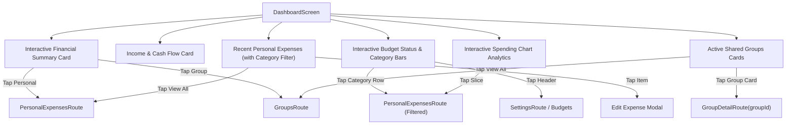

# Dashboard Redesign Blueprint: Interactive & Clickable Architecture

This document outlines the complete redesign strategy for `DashboardScreen.kt`, ensuring that **every single card, metric, category row, budget progress bar, chart element, and section header** is fully interactive and provides instantaneous navigation to its respective screen, filtered view, or detailed modal.

---

## 1. Redesign Objectives & Navigation Mapping

| Dashboard Component / Metric | Current Behavior | Proposed Redesign & Click Action | Target Route / Action |
| :--- | :--- | :--- | :--- |
| **Financial Summary Card** (`Personal Spent`, `Group Spent`) | Static text summary | Clickable card sections | Tapping **Personal Spent** -> `PersonalExpensesRoute` Tapping **Group Spent** -> `GroupsRoute` |
| **Net Group Balance** | Static indicator | Interactive badge | Tapping net balance -> Navigates to the active group with pending debts (`GroupDetailRoute`) |
| **Monthly Income & Cash Flow** | Static summary card | Interactive cash flow card | Tapping income/cash flow -> Opens income-filtered transaction view or cash flow analytics modal |
| **Monthly Budget Status Header & Bars** | Progress indicator only | Fully interactive budget breakdown | Tapping header -> Opens Budget Settings (`SettingsRoute`) Tapping any category row (Food, Rent, etc.) -> Navigates to `PersonalExpensesRoute` filtered by that category |
| **Category Analytics Chart** | Collapsible section | Tap-to-filter chart segments | Tapping any chart slice/category -> Instantly filters recent expenses list by that category |
| **Recent Personal Expenses List** | View All button + item click | Comprehensive item actions | Tapping expense item -> Edit Expense (`onNavigateToEditExpense`) Tapping "View All" -> `PersonalExpensesRoute` |
| **Active Groups Section** | Group card click | Enhanced group widgets | Tapping group card -> Direct navigation to `GroupDetailRoute(groupId)` Tapping "View All" -> `GroupsRoute` |
| **Quick Action FAB** | Expandable mini buttons | 4-way direct action hub | Personal Expense, Group Expense, Receipt OCR Scanner, Create Group |

---

## 2. Proposed UI Component Architecture

---

## 3. Implementation Plan

1. **Update `DashboardScreen.kt`**:
   - Wrap the Financial Summary card sections in `.clickable { ... }` modifiers.
   - Wrap each category row inside the Monthly Budget Status card in `.clickable { onNavigateToPersonalExpenses() ... }` to filter by that category.
   - Wrap the Income/Cash Flow card to open income details or cash flow breakdown.
   - Ensure all group cards and expense items have robust click listeners.
2. **State & Filtering Integration**:
   - Maintain active category filter state in `DashboardScreen` so tapping budget bars or analytics slices immediately filters the dashboard view and updates charts in real time.
3. **Verification**:
   - Run `app:testDebugUnitTest` and verify UI interaction flows.
