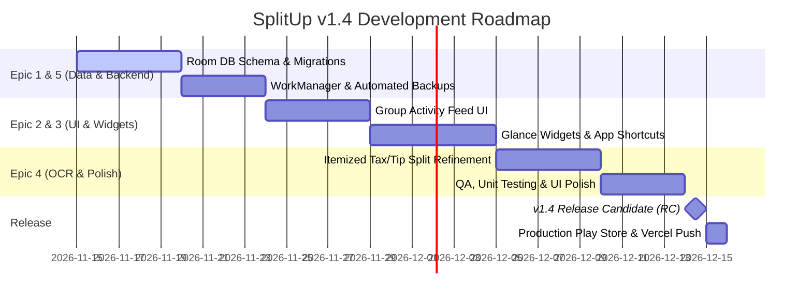

# SplitUp v1.4 Release Roadmap: "Intelligence & Collaboration"

This roadmap outlines the planned features, architectural enhancements, milestones, and release strategy for **SplitUp v1.4**. Building upon the solid foundation of v1.3 (Spending Insights, App Links, UI Polish), v1.4 focuses on deeper financial intelligence, real-time group collaboration, home screen accessibility, and automated backups.

---

## 🎯 Release Objectives & Themes

1. **Smart Budgeting & Forecasting**: Empower users with custom category budget limits, visual progress warnings, and recurring cash flow forecasting.
2. **Enhanced Group Collaboration**: Introduce a group activity feed (audit trail), receipt itemization refinements, and debt reminder notifications.
3. **Accessibility & Quick Actions**: Deliver native Android Home Screen widgets and dynamic app shortcuts for lightning-fast expense logging.
4. **Data Reliability & Travel**: Automated cloud backup scheduling and multi-currency travel mode.

---

## 📋 Epics & Feature Breakdown

### Epic 1: Smart Budgets & Cash Flow Forecasting
- **Custom Category Budgets**: Allow users to set monthly spending limits per category (e.g., Food & Dining, Transport) with live warning banners and progress rings.
- **Cash Flow Forecast**: Project monthly balance based on active subscriptions (`SubscriptionsScreen`) and recurring expenses.
- **Budget Carryover**: Option to carry over unspent budget amounts to the next month.

### Epic 2: Group Activity Feed & Smart Reminders
- **Group Audit Trail / Activity Log**: Real-time activity feed showing who added an expense, edited an amount, settled a balance, or joined the group.
- **Settlement Reminder Push Notifications**: Local notifications and Firebase Cloud Messaging (FCM) prompts to remind friends about pending balances.
- **Comment / Note Thread on Expenses**: Add threaded notes/comments to shared group expenses to clarify bill details.

### Epic 3: Android Home Screen Widgets & Shortcuts
- **Quick-Add Expense Widget**: 2x2 and 4x1 Jetpack Glance / AppWidget providers for one-tap expense logging.
- **Balance Summary Widget**: Glance widget showing net balance across all groups and personal accounts.
- **Dynamic App Shortcuts**: Long-press app icon shortcuts for "Add Expense", "Scan Receipt", and "View Groups".

### Epic 4: Itemized Receipt Splitting & Tax/Tip Distribution
- **Smart Item Allocation**: Improved OCR receipt item parsing with tax and tip proportional distribution across selected group members.
- **Split Customizer**: Percentage-based and share-based item distribution helper UI.

### Epic 5: Automated Backups & Travel Currency Mode
- **Scheduled Cloud Backups**: Background WorkManager tasks for automated weekly/monthly database JSON export to Firebase Storage / Google Drive.
- **Travel Mode**: Automatic currency conversion suggestion when traveling abroad or logging expenses in foreign currencies.

---

## 🗓️ Release Milestones & Timeline

---

## 🧪 Verification & Testing Plan

- **Unit Tests**:
  - Budget calculation and carryover logic tests (`CalculateGroupMetricsUseCaseTest`).
  - Receipt item tax/tip allocation algorithms test.
- **Instrumentation & UI Tests**:
  - Glance widget state verification tests.
  - Group activity feed and expense creation integration tests.
- **Manual Verification**:
  - End-to-end testing of background cloud backup workers using `WorkManager` test inspector.
  - Multi-currency exchange rate accuracy check against live Frankfurter API endpoints.

---
*Created for SplitUp v1.4 Planning Session*
