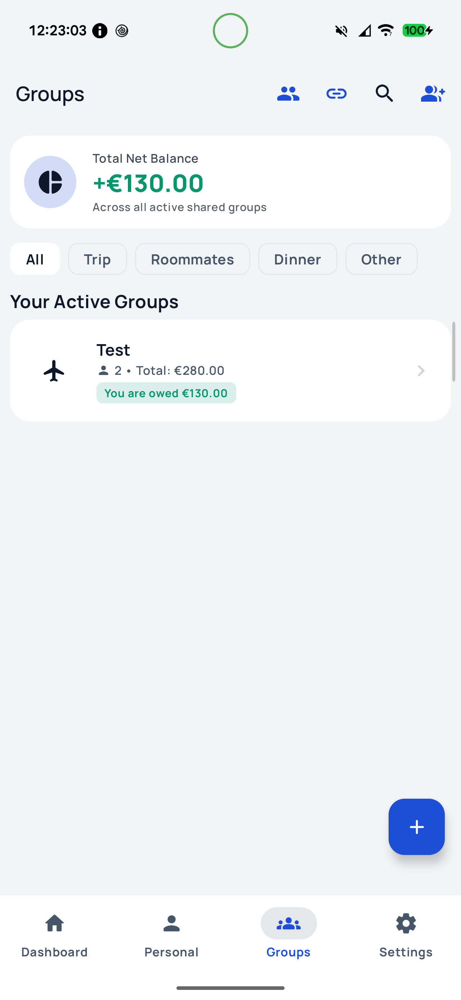
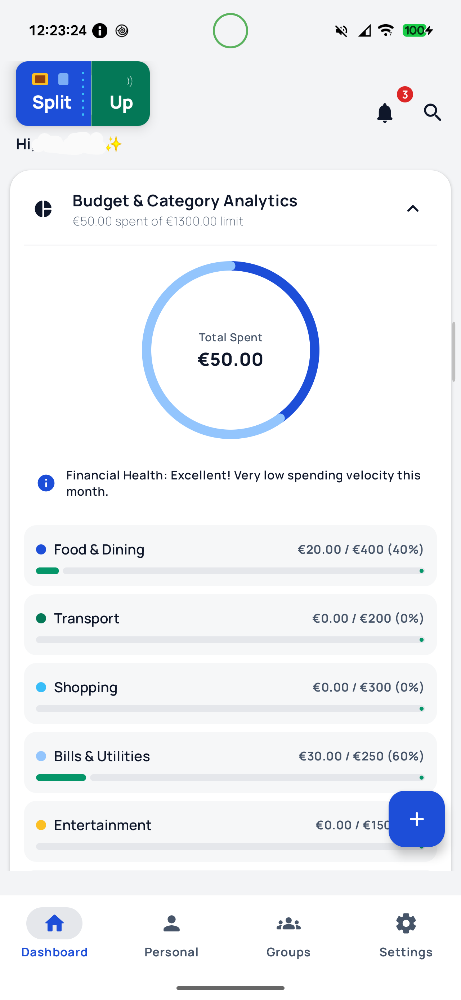
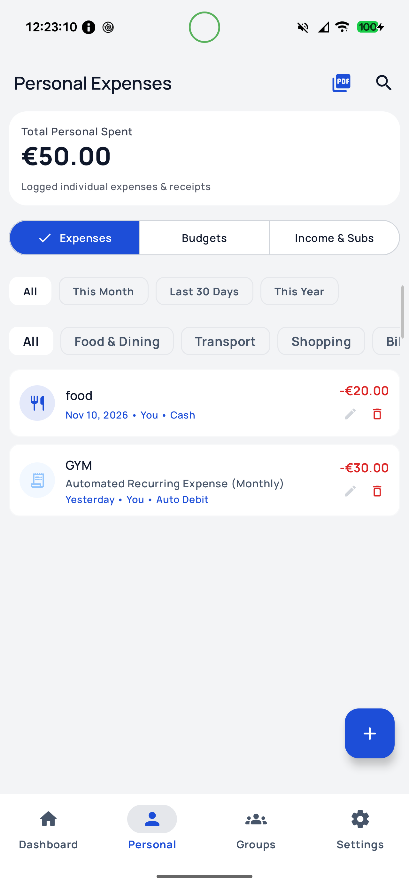
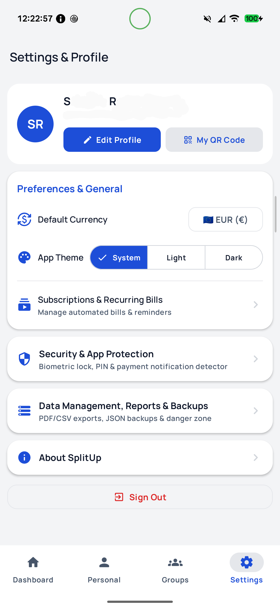
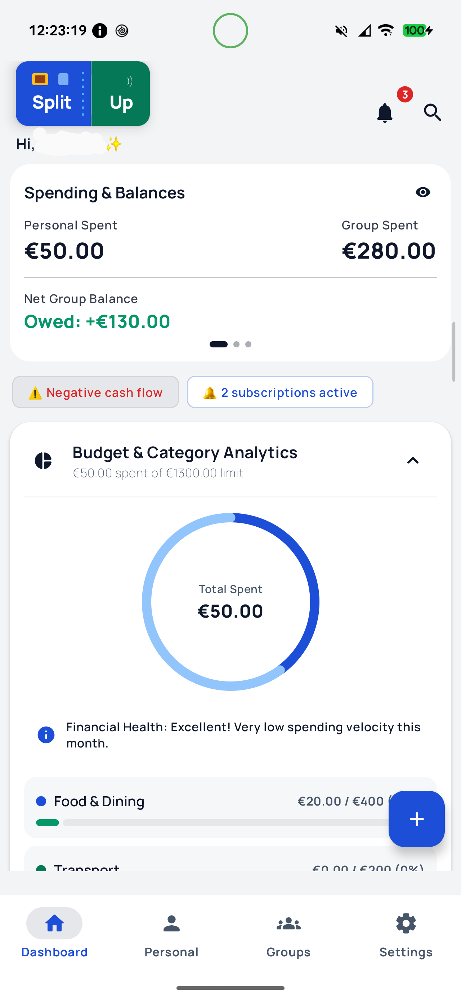

# SplitUp 💸

**SplitUp** is a modern, feature-rich Android application built with **Jetpack Compose** designed for effortless expense splitting, group expense tracking, and personal finance management.

[](https://developer.android.com)
[](https://kotlinlang.org)
[](https://developer.android.com/jetpack/compose)
[](https://github.com/sreejith19931/SplitUp/releases)
[](https://splitupfin.vercel.app)
[](https://opensource.org/licenses/MIT)

---

## ⚡ What's New in v1.2.1

- 🔄 **In-App Update Checker**: Automated GitHub release checking on app launch with pop-up notification and an explicit "Check for Updates" button in the About screen.
- 📱 **Uniform Screenshot Gallery**: Refined website and repository screenshot cards to have consistent uniform heights (`380px`) featuring all 5 core screens (`Groups`, `Analysis`, `Personal Expenses`, `Settings`, `Dashboard`).
- ⚡ **Optimized Stability & Build**: Upgraded to release `1.2.1` with verified signed production builds and zero build warnings.

---

## ✨ Key Features

- **Group Expense Splitting**: Create groups, add shared expenses, split bills equally or custom amounts, and track who owes whom with smart balance simplification.
- **Personal & Group Finance**: Manage both personal expenses and collaborative group funds in one place.
- **Receipt Processing & OCR**: Scan receipts using ML Kit OCR to automatically extract expense details and allocate items among friends.
- **Multi-Currency Support**: Real-time live exchange rates via Frankfurter API & fallback providers for international travel and multi-currency groups.
- **Cloud Sync & Offline Support**: Seamless real-time synchronization with **Firebase Firestore** with robust offline caching via **Room Database** and WorkManager background sync.
- **Security & Biometrics**: Secure your financial data with biometric authentication (Fingerprint / Face unlock) and encrypted preferences.
- **Export & Reports**: Export your data to CSV or generate detailed PDF expense reports.
- **Modern Material 3 UI**: Polished adaptive UI supporting light and dark themes with edge-to-edge support and smooth animations.

---

## 🛠️ Tech Stack & Architecture

- **UI Framework**: [Jetpack Compose](https://developer.android.com/jetpack/compose) & [Material 3](https://m3.material.io/)
- **Architecture**: MVVM with Clean Architecture principles (Repositories, Use Cases, StateFlow)
- **Local Persistence**: [Android Room](https://developer.android.com/training/data-storage/room) & DataStore Preferences
- **Backend & Auth**: [Firebase Firestore](https://firebase.google.com/docs/firestore), Firebase Auth, & Google Credential Manager
- **Networking**: [Retrofit](https://square.github.io/retrofit/) & [Moshi](https://square.github.io/moshi/)
- **Asynchronous Operations**: [Kotlin Coroutines & Flow](https://kotlinlang.org/docs/coroutines-guide.html)
- **Scanning & OCR**: [Google ML Kit Text Recognition](https://developers.google.com/ml-kit/vision/text-recognition) & Barcode Scanning

---

## 📱 Screenshots & Preview

| Groups | Analysis | Personal Expenses | Settings | Dashboard |
| :---: | :---: | :---: | :---: | :---: |
|  |  |  |  |  |

---

## 🚀 Getting Started & Setup

To build and run SplitUp locally:

1. **Clone the repository**:
   ```bash
   git clone https://github.com/sreejith19931/SplitUp.git
   cd SplitUp
   ```

2. **Configure Firebase**:
   - Create a project in the [Firebase Console](https://console.firebase.google.com/).
   - Enable **Authentication** (Google Sign-In / Email) and **Firestore Database**.
   - Download your `google-services.json` file.
   - Place `google-services.json` into the `app/` directory (use `app/google-services.json.template` as a reference if needed).

3. **Open in Android Studio**:
   - Open Android Studio (Ladybug or newer recommended).
   - Select **Open Existing Project** and choose the `SplitUp` folder.
   - Let Gradle sync dependencies and run the app on an emulator or physical device.

---

## 🤝 Contributing

Contributions are welcome! Please feel free to submit a Pull Request or open an Issue for bug reports or feature requests.

1. Fork the repository
2. Create your feature branch (`git checkout -b feature/AmazingFeature`)
3. Commit your changes (`git commit -m 'Add some AmazingFeature'`)
4. Push to the branch (`git push origin feature/AmazingFeature`)
5. Open a Pull Request

---

## 📄 License

Distributed under the **MIT License**. See [LICENSE](LICENSE) for more information.
